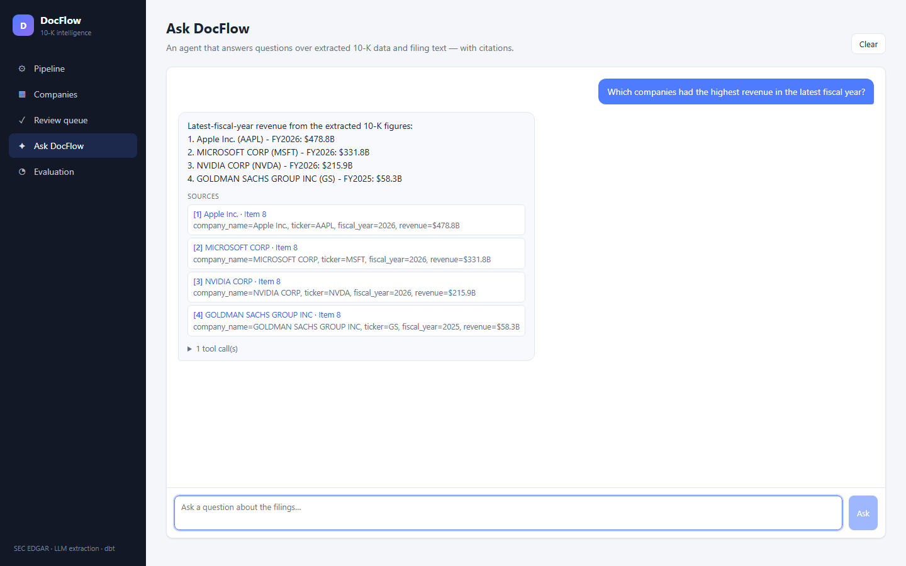
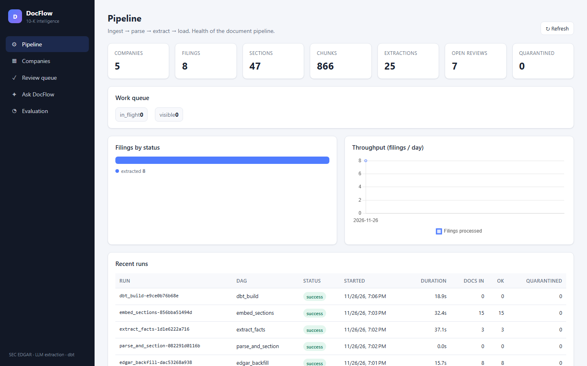
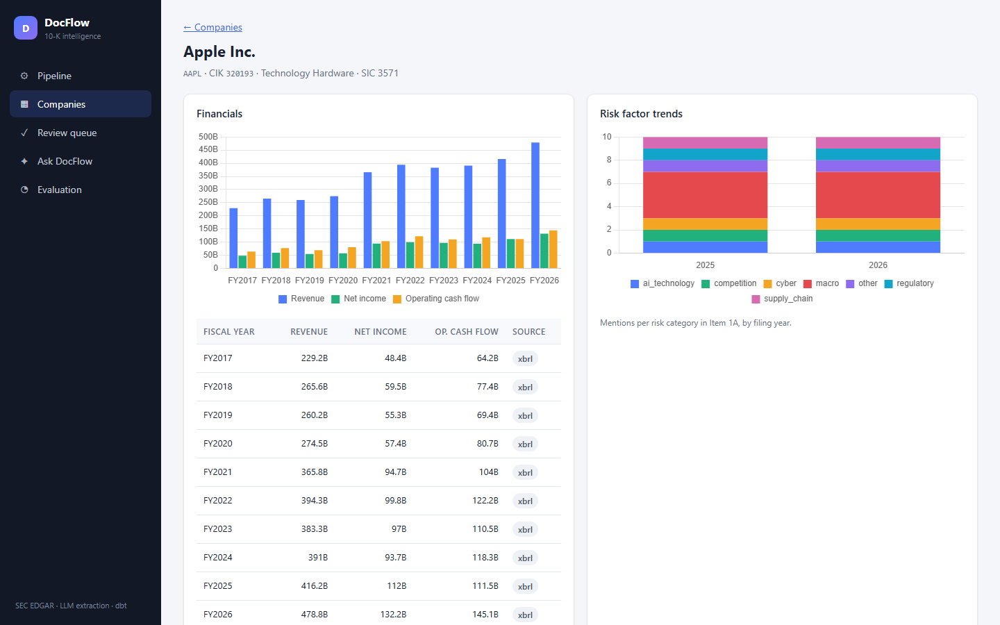
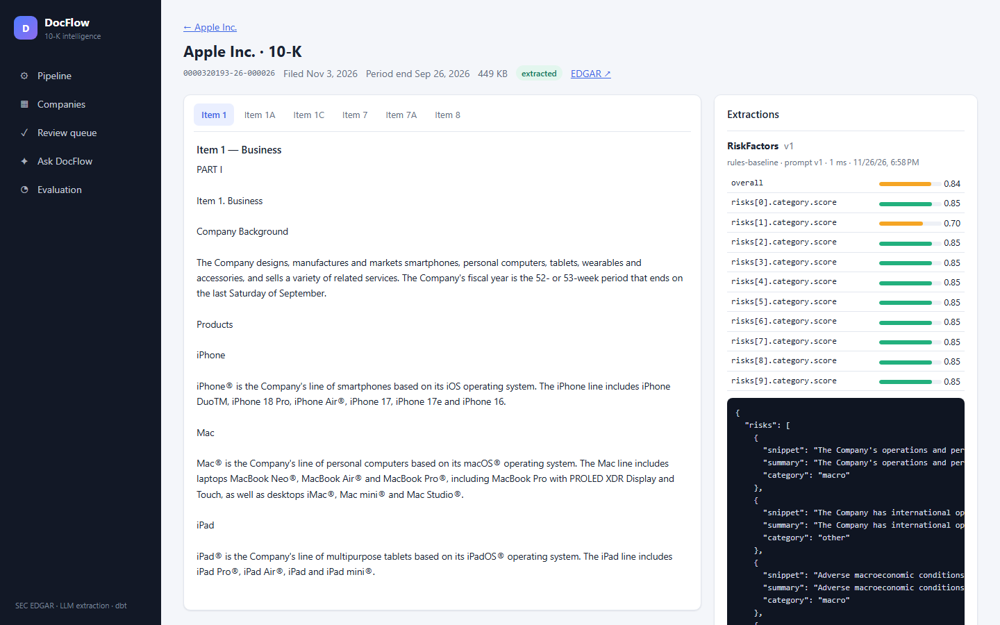
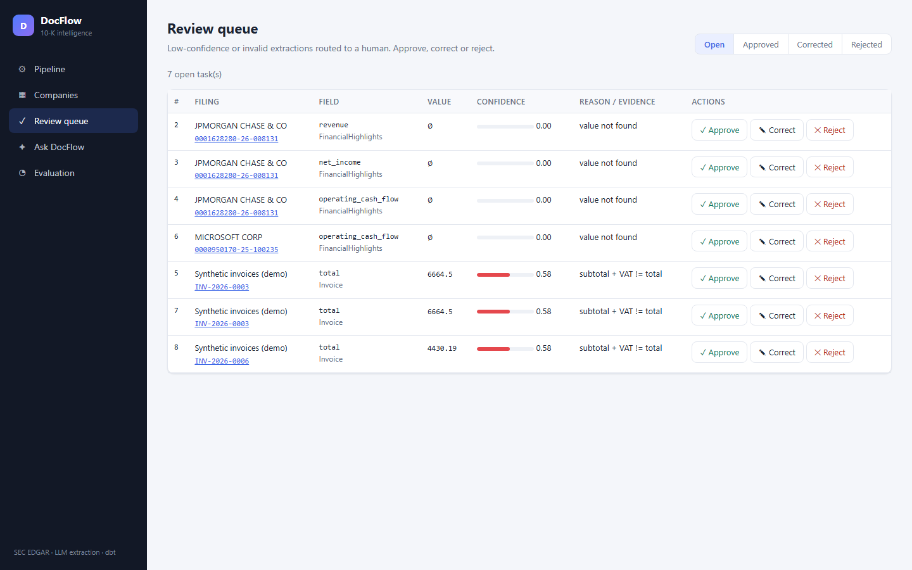
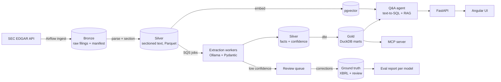

# DocFlow

**AI document intelligence on top of a real data-engineering pipeline.**
DocFlow ingests public SEC EDGAR 10-K filings, splits them into sections, extracts structured facts
with local LLMs (with confidence scores and a human-review queue), models them with dbt, and answers
questions over them with an agent that cites its sources. Everything runs locally with free tools.



| | |
|---|---|
|  |  |
|  |  |

## What it does

1. **Ingest** – the SEC EDGAR API is called for a watch-list of large US tech and financial companies.
   Rate limiting stays within the SEC limit and failed requests are retried. Filings land in a bronze
   layer that never stores duplicates: S3/MinIO plus a manifest checked by accession number and
   checksum.
2. **Parse and section** – HTML, iXBRL and PDF become clean text. The text is split into 10-K Items
   (1 Business, 1A Risk Factors, 1C Cybersecurity, 7 MD&A, 7A, 8 Financial Statements) and stored as
   versioned Parquet (silver). Filings that fail are moved to quarantine.
3. **Extract** – SQS workers call Ollama (`qwen2.5:7b-instruct` / `llama3.1:8b`). The output is
   limited by a JSON schema, checked by Pydantic, and repaired up to 2 times. Extracted items:
   `FinancialHighlights` (revenue, net income, operating cash flow, plus quotes), `RiskFactors`
   (categorised risks with snippets), `Leadership`, and synthetic `Invoice`s. Each field gets a
   confidence score that combines the model's own score, how well the quote matches the source text,
   and domain checks. Fields with low confidence go to a **review queue**, and corrections become
   ground truth.
4. **Model** – a Parquet lake is exported, then `dbt build` (dbt-duckdb) creates the gold marts
   `dim_company`, `dim_sector`, `fct_filings`, `fct_financials` (LLM vs. XBRL), `fct_risk_mentions`,
   `fct_extraction_quality` and `rpt_pipeline_health`, with 40+ data tests.
5. **Evaluate** – every model and prompt version is scored against XBRL company facts (the numbers
   the companies filed themselves) and against reviewer corrections. Reported per field: accuracy,
   schema-valid rate, quarantine rate, p50/p95 latency, docs/hour, and a confidence-threshold
   analysis → [`docs/eval/`](docs/eval).
6. **Ask** – a tool-calling agent answers questions using guarded text-to-SQL over gold, semantic
   search (pgvector) and section text. It cites every answer (filing + item) and refuses anything
   outside the data. The same data is exposed through an **MCP server** ([docs/mcp.md](docs/mcp.md)).
7. **Operate** – 7 Airflow DAGs, OpenTelemetry traces, Prometheus metrics, a Grafana dashboard, and
   Terraform for S3 and SQS (applied to LocalStack and validated against real AWS).

## Architecture



More detail is in [docs/architecture.md](docs/architecture.md).

## Run it

You need Docker, [uv](https://docs.astral.sh/uv/), Node 22 and [Ollama](https://ollama.com) running
natively (for Metal GPU on Apple Silicon).

```bash
cp .env.example .env            # set SEC_USER_AGENT="DocFlow research you@yourmail.com" (no '+' in the email)
make pull-models                # qwen2.5:7b-instruct, llama3.1:8b, nomic-embed-text
make up                         # postgres+pgvector, minio, localstack, api, worker, ui
make demo                       # small mode: ingest -> parse -> extract -> embed -> eval -> dbt
open http://localhost:8080      # UI  (API docs: http://localhost:8000/docs)
```

`make demo-offline` runs the same pipeline without network or Ollama. It uses recorded EDGAR
responses (8 real 10-Ks) and a deterministic rules-based extractor; this is the mode CI uses.
`make up-all` adds Airflow (:8081) and Grafana/Prometheus (:3000/:9090).

| Command | What |
|---|---|
| `make test` / `make test-integration` | unit tests / full pipeline against the running stack |
| `make lint` | ruff, ruff format, mypy (strict) |
| `make dbt` | export the lake + `dbt build` |
| `make eval` | compare `qwen2.5:7b`, `llama3.1:8b` and the rules baseline → `docs/eval/<date>.md` |
| `make e2e` | Playwright (set `E2E_MOCK=1` to run without a backend) |
| `make tf-validate` / `make tf-apply-local` | Terraform against real AWS (validate only) / LocalStack |
| `uv run docflow --help` | every pipeline step as a CLI command |

## Metrics

Offline baseline, measured on the recorded fixture set: 8 real 10-K filings from AAPL, MSFT, NVDA,
JPM and GS (2025–2026). The ground truth is the XBRL company facts, matched within 0.5%:

| Extractor | schema-valid | revenue | net income | op. cash flow | fiscal year |
|---|---|---|---|---|---|
| rules-baseline (regex, CI) | 1.00 | 0.88 | 0.88 | 0.50 | 1.00 |

The misses are informative. JPMorgan publishes its financial statements in an exhibit rather than in
the 10-K body. Goldman Sachs shows cash-flow lines that the regex misreads. Both cases end up in the
review queue, which is the point of the confidence design ([ADR-0004](docs/adr/0004-confidence-and-review-threshold.md)).

LLM results (`qwen2.5:7b` vs `llama3.1:8b`, both prompt versions, latency and docs/hour on Apple
Silicon) are produced by `make eval` and written to [`docs/eval/`](docs/eval).

## Design decisions

| ADR | Decision |
|---|---|
| [0001](docs/adr/0001-stack.md) | Free, local, AWS-compatible stack |
| [0002](docs/adr/0002-medallion-lake-and-duckdb.md) | Medallion layers, Parquet lake, DuckDB gold read-only by the API |
| [0003](docs/adr/0003-local-llm-structured-output.md) | Ollama + JSON-schema output + repair loop + rules baseline |
| [0004](docs/adr/0004-confidence-and-review-threshold.md) | Field confidence formula and the 0.7 review threshold |
| [0005](docs/adr/0005-queue-and-workers.md) | SQS work queue with DLQ |
| [0006](docs/adr/0006-xbrl-ground-truth.md) | XBRL company facts as ground truth |
| [0007](docs/adr/0007-text-to-sql-guardrails.md) | Agent guardrails: sqlglot allow-list, read-only, limits, refusals |
| [0008](docs/adr/0008-sectioning-heuristic.md) | Deterministic 10-K sectioning |

## Repository layout

```
core/           config, db, models + Alembic migrations, storage (S3), queue (SQS), telemetry, CLI
ingestion/      EDGAR client, rate limiter, offline fixtures, bronze writer, watch-list
processing/     parsing, sectioning, silver, schemas, prompts, LLM providers, extraction, worker,
                embeddings, ground truth, evaluation, lake export, synthetic invoices
api/            FastAPI app + routers, Q&A agent (tools, SQL guard), MCP server
warehouse/      dbt project (staging -> intermediate -> marts, tests)
airflow/        DAGs + image
ui/             Angular app + Playwright E2E
infra/          Terraform (S3 + SQS), Postgres init
observability/  OTel collector, Prometheus, Grafana dashboard
tests/          unit, integration, recorded EDGAR fixtures
docs/           plan, architecture, ADRs, eval reports, MCP
```

## Data and legal notes

The project uses only the public SEC EDGAR API, under the SEC fair-access policy: at most 8
requests/second, and a descriptive User-Agent with a contact email. Invoices are synthetic, with
made-up vendors.

## License

MIT
