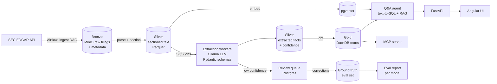

# DocFlow — Plan

AI document intelligence on top of a real data-engineering pipeline.
Ingests public SEC EDGAR filings at scale, extracts structured facts with local LLMs,
models them for analytics, and answers questions over them with an agent that cites its sources.

Portfolio project: built to show production-grade Applied AI + Data Engineering work.

---

## 1. Hard constraints

- **Free only.** No paid APIs, no trials, no cloud bills. Everything runs locally with `docker compose` on a MacBook (Apple Silicon).
- **Real data, legally.** SEC EDGAR public API only (respect the 10 requests/second limit and send a descriptive `User-Agent` with a contact email). Synthetic invoices only for the human-review demo.
- **No employer material.** No code, names or data from any past or current employer or client.
- **Reproducible.** `make up && make demo` brings up a working small-mode demo (~500 filings) in under 30 minutes.
- **Defensible.** Every non-obvious choice has a short ADR in `docs/adr/`.

## 2. Tech stack

| Area | Choice | Why |
|---|---|---|
| Language | Python 3.12, TypeScript (strict) | Core skills |
| API | FastAPI, Pydantic v2 | Typed, async, OpenAPI out of the box |
| Database | PostgreSQL 16 + pgvector | App state, review queue, embeddings |
| ORM / migrations | SQLAlchemy 2 + Alembic | Standard, versioned schema |
| Object storage | MinIO (S3 API) | S3-compatible, free |
| Queue | LocalStack SQS (community) | Same code path as real AWS SQS |
| Orchestration | Apache Airflow 2.x | Most requested orchestrator in job ads |
| Transformations | dbt-core + dbt-duckdb | Analytics engineering, tests, docs |
| Warehouse | DuckDB over Parquet | Free, fast, file-based |
| Data quality | dbt tests + Pydantic schema contracts | Contracts at boundaries, tests in the warehouse |
| LLM | Ollama: `qwen2.5:7b-instruct` (default), `llama3.1:8b` (comparison) | Free, local, structured JSON output |
| Embeddings | Ollama `nomic-embed-text` → pgvector | Free semantic search |
| Agent tools | MCP server (Python SDK) + tool-calling agent | Interop with other agents |
| Frontend | Angular (latest, standalone components, signals) | Core skill |
| IaC | Terraform → LocalStack; must also `validate` against real AWS | Infra as code without cost |
| Observability | OpenTelemetry → Prometheus + Grafana; structured JSON logs | Production habits |
| Testing | pytest, Playwright (E2E), dbt tests | Unit, integration, end to end |
| Lint / types | ruff, mypy, ESLint, Prettier | CI gates |
| CI | GitHub Actions (public repo = free) | Lint, types, tests, dbt build, small-mode E2E |

## 3. Architecture



### Medallion layers
- **Bronze** — raw filings exactly as downloaded (`s3://docflow-bronze/{cik}/{accession}/…`) and a `filings` manifest (CIK, form type, filing date, URL, checksum, ingest run id). Append-only, idempotent: a re-run never duplicates (checksum + accession number).
- **Silver** — cleaned text split into sections (Item 1 Business, Item 1A Risk Factors, Item 7 MD&A, financial statements), stored as Parquet with a versioned schema; LLM-extracted facts with per-field confidence and the model and prompt version used.
- **Gold** — dbt marts in DuckDB: `dim_company`, `dim_sector`, `fct_financials` (revenue, net income, operating cash flow by period), `fct_risk_mentions` (risk category × company × year), `fct_extraction_quality`.

## 4. Data model (core)

- `companies(cik, name, ticker, sic_code, sector)`
- `filings(accession_no, cik, form_type, filed_at, period_end, source_url, checksum, bronze_key, status)`
- `sections(id, accession_no, item, text_key, char_count, token_estimate)`
- `extractions(id, accession_no, schema_name, schema_version, model, prompt_version, payload_json, confidence_json, latency_ms, created_at)`
- `review_tasks(id, extraction_id, field, value, confidence, status, reviewer_value, reviewed_at)`
- `ground_truth(id, accession_no, field, value, source)` — seeded by hand (~50 filings), grown from review corrections
- `pipeline_runs(run_id, dag_id, started_at, finished_at, docs_in, docs_ok, docs_quarantined)`
- `quarantine(accession_no, stage, error, payload_key, created_at)`

## 5. Extraction schemas (Pydantic)

- `FinancialHighlights`: fiscal year, revenue, net income, operating cash flow, currency, units — each with the source section and a quoted snippet.
- `RiskFactors`: list of risks, each with category (AI/technology, cyber, regulatory, supply chain, macro, competition, other), a one-line summary and a snippet.
- `Leadership`: CEO, CFO, board size (8-K / DEF 14A when available).
- `Invoice` (synthetic demo only): vendor, invoice number, dates, line items, totals, VAT.

Rules: JSON-schema-constrained output from Ollama, Pydantic validation, up to 2 repair retries, then quarantine. Confidence = model self-score combined with validation signals (cross-checks such as revenue ≥ 0, period matches filing).

## 6. Pipelines (Airflow DAGs)

1. `edgar_ingest_daily` — new filings for a watch-list of companies (S&P 500 tech + financials to start); incremental by filing date.
2. `edgar_backfill` — parameterized years and form types; parallel by CIK with rate limiting.
3. `parse_and_section` — bronze → silver text; failures go to quarantine.
4. `extract_facts` — enqueue sections to SQS; workers call Ollama; results land in silver.
5. `embed_sections` — sections → pgvector.
6. `dbt_build` — `dbt build` (models + tests), then publish the data-quality report.
7. `eval_nightly` — run both models on the ground-truth set, write the eval report.

Every DAG: retries with backoff, idempotent tasks, run metrics written to `pipeline_runs`, OpenTelemetry spans.

## 7. Evaluation

- Ground truth: ~50 filings labeled by hand for `FinancialHighlights` and `RiskFactors`, plus review-queue corrections.
- Metrics: per-field exact/normalized match, precision/recall for risk categories, schema-valid rate, quarantine rate, latency p50/p95, docs/hour.
- Report: `docs/eval/<date>.md` + a dashboard page comparing `qwen2.5:7b` and `llama3.1:8b` and prompt versions; the chosen confidence threshold and why.

## 8. Agent and MCP

- **Q&A agent** (FastAPI endpoint + UI chat): tools `sql_query` (read-only DuckDB on gold, allow-listed tables, row limit, timeout), `semantic_search` (pgvector over sections), `get_filing_section`. Every answer cites filing + section. Refuses questions outside the data.
- **MCP server**: tools `search_filings`, `get_company_financials`, `get_risk_trends`, `get_section_text`; usable from Claude Desktop or any MCP client.

## 9. Frontend (Angular)

Pages: pipeline overview (runs, throughput, quarantine), company explorer (financials + risk trends charts), filing viewer (section text with extracted fields highlighted), review queue (approve/correct low-confidence fields), Q&A chat with citations, eval dashboard.

## 10. Repository layout

```
docflow/
├─ docker-compose.yml          # postgres, minio, localstack, airflow, ollama*, api, worker, ui, grafana
├─ Makefile                    # up, down, demo, test, lint, dbt, eval
├─ docs/  PLAN.md  adr/  eval/  architecture.md
├─ ingestion/                  # EDGAR client, rate limiter, bronze writer
├─ processing/                 # parsing, sectioning, extraction workers, schemas
├─ airflow/dags/
├─ warehouse/                  # dbt project (dbt-duckdb)
├─ api/                        # FastAPI app, agent, MCP server
├─ ui/                         # Angular app
├─ infra/terraform/            # LocalStack + AWS-valid modules
├─ observability/              # otel collector, prometheus, grafana dashboards
├─ tests/                      # unit, integration, e2e (Playwright)
└─ .github/workflows/
```
*Ollama runs natively on macOS for GPU (Metal) speed; compose points to `host.docker.internal:11434`.

## 11. Milestones (each one shippable, tested, committed)

1. **Foundation** — repo layout, docker compose (Postgres, MinIO, LocalStack), Makefile, CI with ruff/mypy/pytest, CLAUDE.md, ADR-001 (stack).
2. **Bronze ingestion** — EDGAR client with rate limiting and retries, idempotent bronze writer, manifest table, Alembic migrations, tests with recorded HTTP fixtures. Backfill 500 filings.
3. **Silver text** — HTML/PDF parsing, sectioning of 10-K items, Parquet output with schema version, quarantine path.
4. **Warehouse** — dbt-duckdb project, staging + marts for companies and filings, dbt tests, data-quality report. *(First "serious" demo point.)*
5. **Airflow** — all ingestion/processing DAGs, backfill DAG, run metrics, Grafana dashboard for throughput and failures.
6. **LLM extraction** — Ollama provider, schemas, SQS workers, confidence, review queue tables; `fct_financials` and `fct_risk_mentions` marts.
7. **Evaluation** — ground-truth set, eval harness, two-model comparison report, threshold choice (ADR).
8. **Agent + MCP** — text-to-SQL with guardrails, semantic search, citations, MCP server, tests for refusal and SQL safety.
9. **Angular UI** — all pages, Playwright E2E in CI (small mode).
10. **Terraform + polish** — LocalStack apply, real-AWS `validate`, README with architecture diagram, screenshots, metrics table, 2-minute demo GIF.

## 12. Definition of done (whole project)

- `make up && make demo` works on a clean Mac.
- CI green: lint, types, unit, integration, dbt build, E2E (small mode).
- README shows: what it does, the architecture diagram, how to run it in ≤5 commands, the metrics (filings ingested, docs/hour, extraction accuracy per model, hardware), and the design decisions.
- At least 10k filings ingested to bronze/silver; LLM extraction on ≥1,000 filings.
