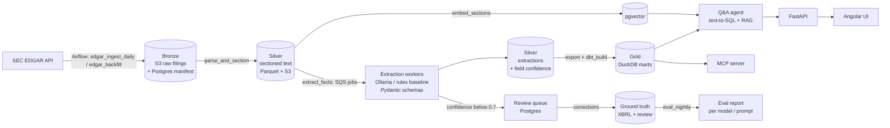

# Architecture

## Components

| Path | Responsibility |
|---|---|
| `ingestion/` | EDGAR client (shared 8 req/s token bucket, retries with jittered backoff, required contact User-Agent), offline fixture transport, idempotent bronze writer, watch-list, SIC → sector |
| `processing/parse.py`, `sectioning.py`, `silver.py` | HTML/iXBRL/PDF → text, 10-K item detection, silver Parquet, quarantine |
| `processing/schemas.py`, `prompts.py`, `context.py`, `llm.py`, `extract.py` | Extraction schemas, versioned prompts, context compression, providers, validation/repair, confidence, review tasks |
| `processing/worker.py` | SQS producer/consumer (DLQ after 3 receives) and the in-process equivalent |
| `processing/embed.py` | Chunking, embeddings, pgvector similarity search |
| `processing/ground_truth.py`, `evaluation.py` | XBRL ground truth, eval harness, Markdown report |
| `processing/export.py`, `warehouse/` | Parquet lake export, dbt staging → intermediate → marts, tests |
| `api/` | FastAPI routers, agent (tools, SQL guard), MCP server |
| `airflow/dags/` | One DAG per pipeline stage, retries with exponential backoff |
| `ui/` | Angular app + Playwright E2E |
| `infra/terraform/` | S3 buckets + SQS queue/DLQ for LocalStack and AWS |
| `observability/` | OTel collector, Prometheus, Grafana dashboard |

## Data model (Postgres)

`companies`, `filings` (manifest: checksum, bronze key, status `ingested → parsed → extracted | quarantined`),
`sections`, `section_chunks` (pgvector, HNSW cosine index), `extractions` (payload + confidence JSONB,
model, prompt version, attempts, latency, run tag), `review_tasks`, `ground_truth`, `pipeline_runs`,
`quarantine`, `eval_runs`. Migrations: `core/migrations` (Alembic).

## Gold marts (DuckDB)

`dim_company`, `dim_sector`, `fct_filings`, `fct_financials` (company × fiscal year × source `llm|xbrl`,
reviewer corrections applied), `fct_risk_mentions`, `fct_extraction_quality` (per model × prompt ×
schema: confidence, latency, review rate, XBRL match rate), `rpt_pipeline_health` (runs, quarantine
rate, docs/hour per DAG).

## Offline mode

`EDGAR_FIXTURES_DIR=tests/fixtures/edgar` serves recorded, trimmed EDGAR responses (8 real 10-Ks from
Apple, Microsoft, NVIDIA, JPMorgan and Goldman Sachs) and `LLM_PROVIDER=fake` swaps Ollama for the
deterministic rules provider and a hashing embedder. CI runs the whole pipeline this way.
